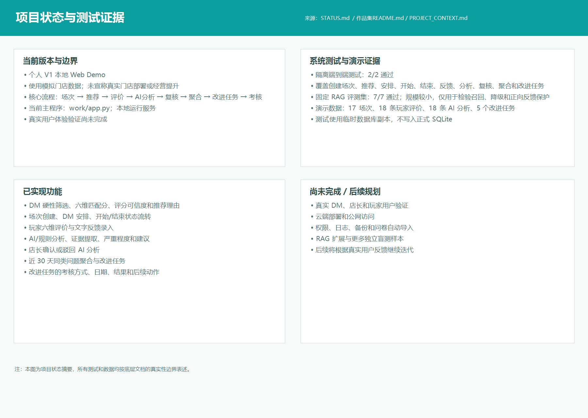
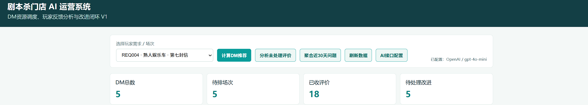
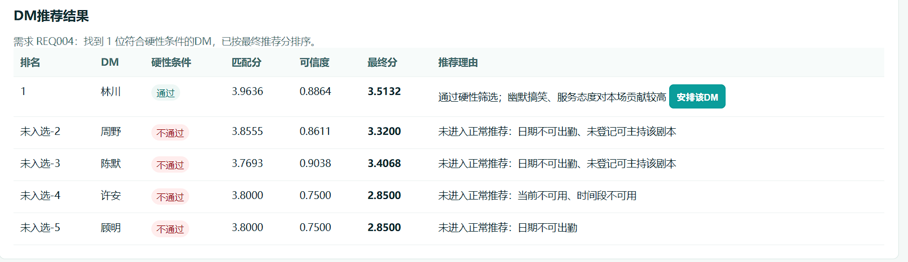
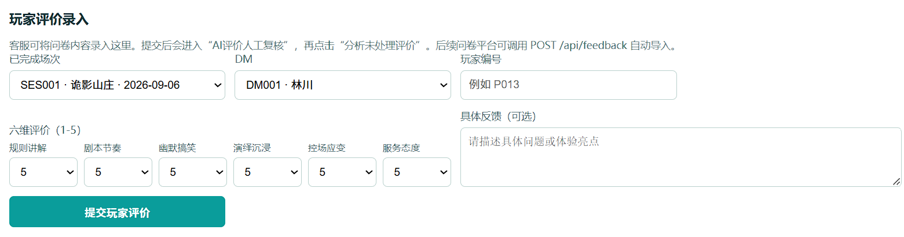
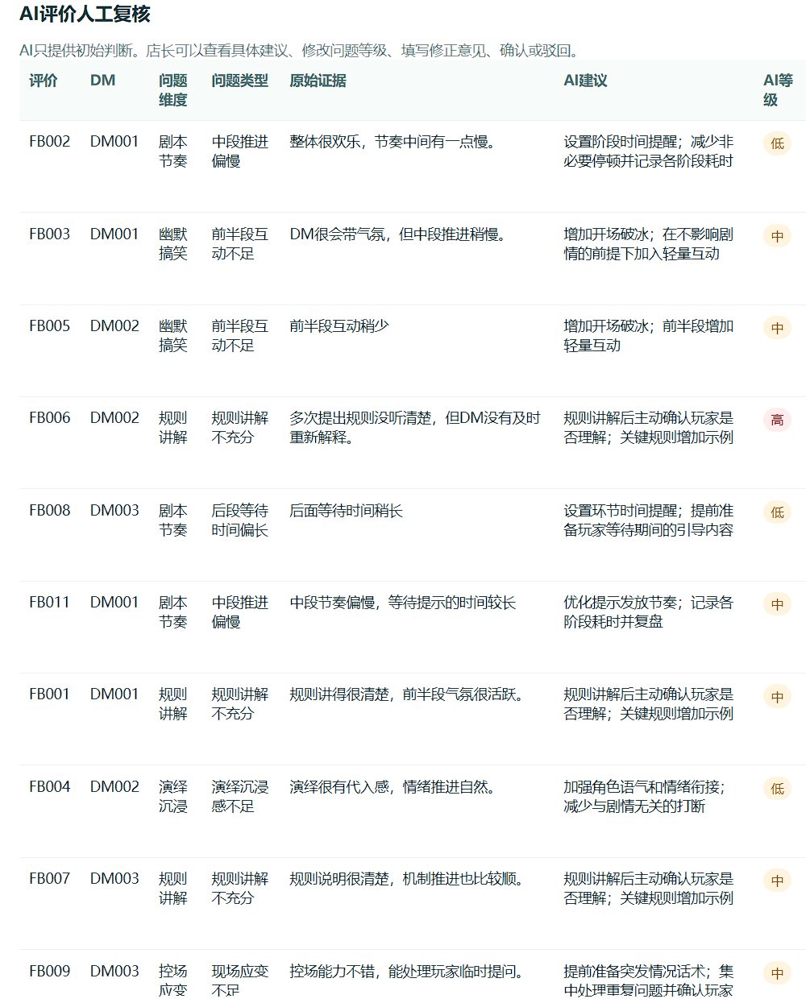
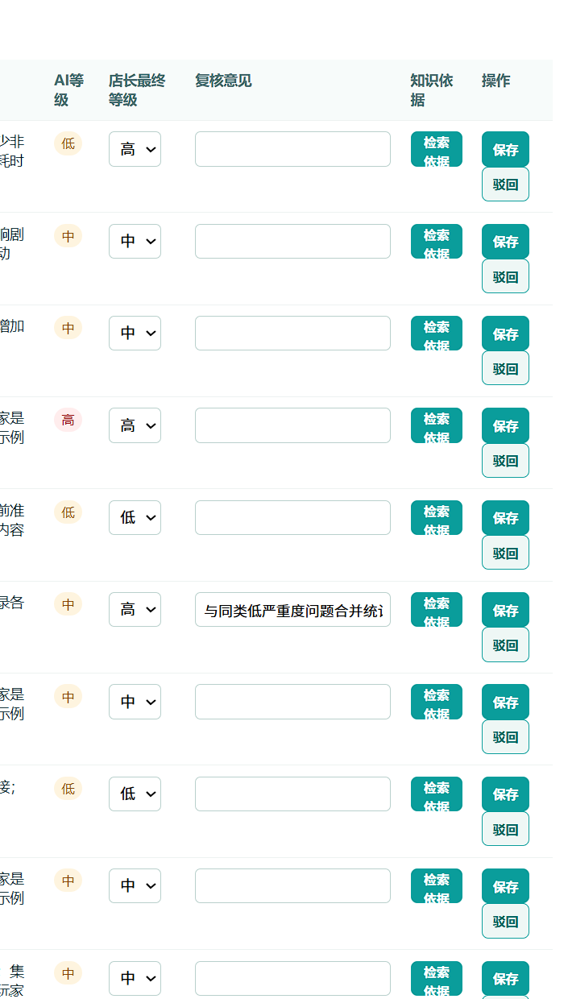
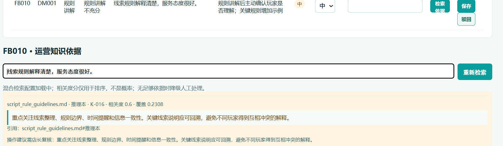
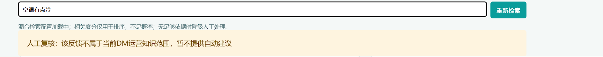
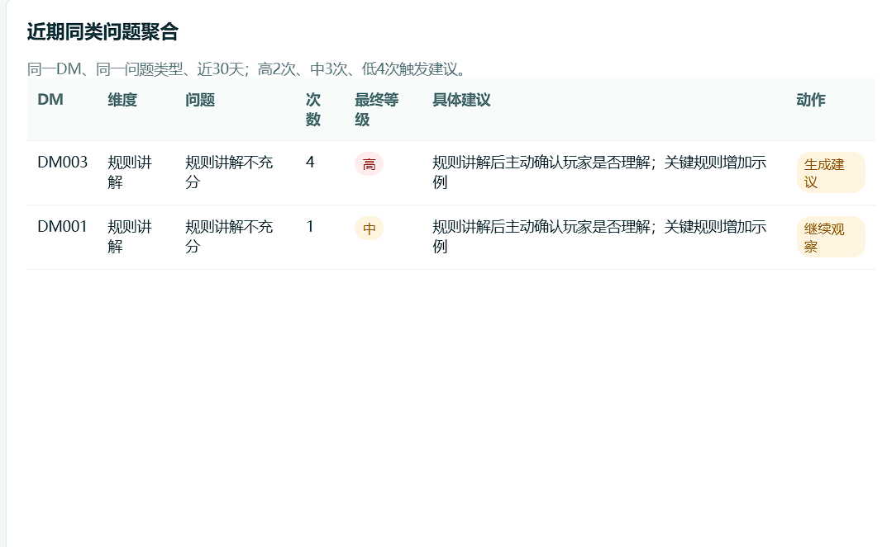
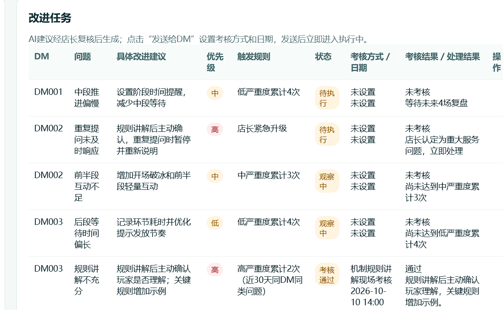

# 剧本杀门店 AI 体验运营与资源调度助手

> 个人 V1 本地 Web Demo：将 DM 推荐、玩家反馈、AI 初步分析、店长人工复核、问题聚合和改进任务串成可追踪的运营闭环。

[](docs/STATUS.md)
[](requirements.txt)

## HR 快速阅读

这个项目重点展示四类能力：

- **AI 产品运营**：把玩家文字反馈转成问题、证据、严重程度和可跟进任务。
- **AI 产品设计**：用确定性规则处理硬约束，用 AI 处理反馈结构化，并保留店长人工判断。
- **AI 项目运营**：设计状态流转、人工复核、问题聚合、改进任务和现场考核闭环。
- **FDE / AI 应用交付**：完成本地 Web Demo、SQLite 数据持久化、RAG 依据层、降级逻辑和测试材料。

项目使用模拟门店数据，不代表真实门店上线、生产准确率或经营效果。

## 90 秒看懂项目



核心业务闭环：

```text
创建场次
  -> DM 硬性筛选与六维推荐
  -> 安排并执行场次
  -> 录入玩家评价
  -> AI / 本地规则分析
  -> 店长确认或驳回
  -> 近 30 天同类问题聚合
  -> 改进任务与现场考核
```

## 关键界面

### 1. 业务总览与推荐





### 2. 反馈、AI 分析与人工复核







### 3. RAG 依据与失败处理





项目对范围外反馈不强行生成答案，而是转人工复核；对笼统反馈要求补充具体场景，对正向反馈记录亮点而不生成负向任务。

### 4. 问题聚合与改进任务





## 我的贡献

- 用户角色、业务流程和数据结构拆解；
- DM 能力模型、玩家需求权重和推荐规则；
- AI 反馈分析、证据提取、严重程度和建议流程；
- 人工复核、正向反馈保护、无依据/范围外降级；
- RAG 知识依据层、来源引用和固定评测用例；
- 本地 Web Demo、SQLite 持久化和端到端测试。

## 主要能力

- **规则与模型协同**：日期、时间、剧本能力和场次冲突使用确定性规则；AI 用于反馈结构化和知识依据辅助。
- **结果可控**：AI 初步分析必须经过店长确认，已驳回或待复核结果不参与问题聚合。
- **失败处理**：范围外反馈转人工，笼统反馈要求补充场景，正向反馈记录亮点而不生成负向任务。
- **可追溯**：RAG 返回来源文档、章节、片段和相关度排序信息。

## 目录

- `app.py`：本地 Web Demo
- `rag/`：BM25 与可选 Embedding 检索、评测用例
- `rag_knowledge/`：模拟运营知识文档
- `test_e2e_flow.py`：隔离端到端测试
- `assets/`：项目展示截图与状态证据
- `docs/`：项目说明与演示材料
- `.env.example`：环境变量模板，不含真实密钥

## 本地运行

需要 Python 3.11+，项目运行时仅使用 Python 标准库。

```powershell
python app.py
```

浏览器打开：`http://127.0.0.1:8765/`

如果需要启用可选 Embedding 检索，请在本地终端设置环境变量，不要把真实 Key 写进代码或提交到 GitHub：

```powershell
$env:DASHSCOPE_API_KEY = "你的本地密钥"
$env:DASHSCOPE_BASE_URL = "https://dashscope.aliyuncs.com/compatible-mode/v1"
$env:DASHSCOPE_EMBEDDING_MODEL = "text-embedding-v4"
$env:DASHSCOPE_EMBEDDING_DIMENSION = "1024"
```

没有配置 Key 时，系统使用本地/BM25 fallback 模式。

## 测试

```powershell
python rag/evaluate_rag.py
python -m unittest test_e2e_flow.py -v
```

项目中的评测和端到端测试仅用于个人 Demo 验证，不代表生产环境准确率、真实用户效果或经营收益。

## 当前边界

- 当前是个人 V1 本地 Demo，使用模拟门店数据；
- 尚未完成真实 DM、店长和玩家用户验证；
- 尚未完成云端部署、权限、日志、备份和问卷自动导入；
- 不上传 SQLite 数据库、API Key、个人隐私和本机日志。

## 相关材料

- [项目状态与测试证据](assets/12-项目状态与测试证据.png)
- [最新 Demo 录屏分镜](docs/Demo录屏分镜_最新录制版_2026-10-08.md)
- [RAG 评测说明](rag/EVALUATION.md)
